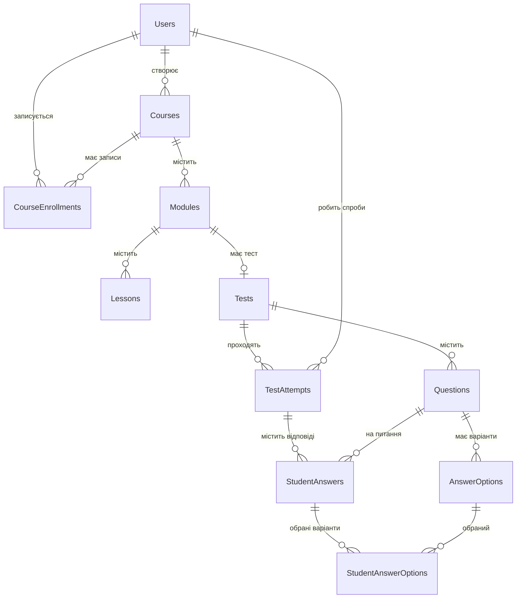

# E-Learning Academy

Інтерактивна платформа дистанційного навчання та тестування.
Курсова робота: C#, .NET 8, Windows Forms, MySQL / MariaDB (XAMPP), Entity Framework Core 8, ClosedXML.

---

## 1. Що потрібно встановити

- **Windows 10/11**.
- **Visual Studio 2022** з робочим навантаженням **«.NET desktop development»**.
- **XAMPP** (https://www.apachefriends.org) — з нього потрібен лише модуль **MySQL** (насправді це MariaDB).
- Інтернет під час першої збірки (Visual Studio завантажить пакети NuGet).

## 2. Як запустити

1. Відкрийте **XAMPP Control Panel** і натисніть **Start** навпроти **MySQL**. Напис має стати зеленим (порт 3306).
2. Розпакуйте архів і відкрийте **`ELearningAcademy.sln`** у Visual Studio 2022.
3. Дочекайтеся відновлення пакетів NuGet. Якщо не почалося — ПКМ по рішенню → **Восстановить пакеты NuGet**.
4. Натисніть **F5**.
5. При першому запуску програма **сама створить базу `elearning_academy`** у MySQL і заповнить її демо-даними.
   Базу можна переглянути в phpMyAdmin: http://localhost/phpmyadmin (для цього в XAMPP має бути запущений і Apache).

### Налаштування підключення (`ELearningAcademy/appsettings.json`)

```json
{
  "ConnectionString": "Server=localhost;Port=3306;Database=elearning_academy;User=root;Password=;CharSet=utf8mb4;",
  "MySqlServerVersion": "10.4.32-mariadb"
}
```

- За замовчуванням у XAMPP користувач `root` **без пароля**. Якщо ви встановили пароль — впишіть його після `Password=`.
- Якщо MySQL у XAMPP працює на іншому порту — змініть `Port=3306`.
- `MySqlServerVersion` — версія сервера. У XAMPP 8.x це MariaDB 10.4. Точну версію видно в phpMyAdmin на головній сторінці («Версія сервера»). Для «справжнього» MySQL 8 вкажіть, наприклад, `8.0.36-mysql`.

### Демо-акаунти

| Роль | Логін | Пароль |
|---|---|---|
| Викладач «Професор Денис» | `teacher` | `teacher123` |
| Студент (новий, без спроб) | `student` | `student123` |
| Студент (модуль 1 складено, модуль 2 — ні) | `student2` | `student123` |
| Студент «Денис С.» (новий, без спроб) | `denys` | `student123` |

Можна також зареєструвати нового студента кнопкою «Реєстрація нового студента».

### Демо-курс

**«Основи програмування на C#»** (опубліковано, `student`, `student2` і `denys` записані):

- Модуль 1. Вступ до програмування — уроки «Що таке C#?», «Змінні та типи даних»; тест: 4 питання, 5 балів (усі три типи питань).
- Модуль 2. Умовні конструкції — уроки «Оператор if», «Оператор switch»; тест: 3 питання, 5 балів (одне — із зображенням блок-схеми).
- Модуль 3. Цикли — уроки «Цикл for», «Цикли while і do-while»; тест: 3 питання, 4 бали.

**«Основи баз даних та SQL»** — опубліковано, на нього ніхто не записаний (для показу запису на курс).

## 3. Якщо щось не працює

| Проблема | Рішення |
|---|---|
| «Unable to connect to any of the specified MySQL hosts» | У XAMPP Control Panel не запущено MySQL — натисніть **Start** |
| MySQL у XAMPP не стартує (порт 3306 зайнятий) | Інша програма займає порт (часто встановлений окремо MySQL). Зупиніть її або в XAMPP: Config → my.ini → змініть `port=3306` на `3307` і так само в `appsettings.json` |
| «Access denied for user 'root'» | Для root встановлено пароль — вкажіть його в `Password=` у `appsettings.json` |
| Українські літери показуються як «????» | База була створена вручну з іншим кодуванням. Видаліть базу `elearning_academy` у phpMyAdmin — програма створить її заново в `utf8mb4` |
| Хочу почати з чистої бази | phpMyAdmin → база `elearning_academy` → «Операції» → «Видалити базу даних». При наступному запуску програма створить її заново |
| Помилки NuGet | Сервис → Диспетчер пакетов NuGet → Параметры → перевірте, що є джерело `nuget.org` |

## 4. Структура проєкту

```
ELearningAcademy/
├─ ELearningAcademy.sln            файл рішення Visual Studio
├─ README.md                       ця інструкція
├─ Database/
│  └─ MySQL/                       скрипти для phpMyAdmin (XAMPP)
│     ├─ 01_CreateDatabase.sql     створення всіх таблиць
│     └─ 02_SeedData.sql           спрощені початкові дані
└─ ELearningAcademy/
   ├─ ELearningAcademy.csproj      проєкт: .NET 8, WinForms, NuGet-пакети
   ├─ appsettings.json             вибір СУБД і рядки підключення
   ├─ Program.cs                   точка входу
   ├─ Models/                      класи-таблиці БД (11 сутностей + 2 enum)
   │  └─ Dto/                      класи для передачі даних між шарами та для таблиць на формах
   ├─ Data/
   │  ├─ AppDbContext.cs           контекст EF Core: таблиці, ключі, зв'язки, обмеження
   │  ├─ DbSeeder.cs               демо-дані
   │  └─ DatabaseInitializer.cs    створення БД при першому запуску
   ├─ Services/                    бізнес-логіка
   │  ├─ AuthService.cs            вхід, реєстрація
   │  ├─ CourseService.cs          курси, запис на курс
   │  ├─ ModuleService.cs          модулі
   │  ├─ LessonService.cs          уроки
   │  ├─ TestService.cs            конструктор тестів, проходження, збереження спроби
   │  ├─ GradingService.cs         автоматичне оцінювання
   │  ├─ ModuleAccessService.cs    блокування модулів (правило 70%)
   │  └─ ProgressService.cs        прогрес, результати, статистика
   ├─ Helpers/                     хешування паролів, сесія, стиль, зображення, RTF
   ├─ Reports/
   │  └─ ExcelReportGenerator.cs   Excel-звіти (ClosedXML)
   └─ Forms/                       13 форм (кожна: .cs — логіка, .Designer.cs — розмітка)
```

### Форми

| Форма | Призначення |
|---|---|
| LoginForm | Авторизація |
| RegisterForm | Реєстрація студента (додаткова) |
| MainForm | Головне меню, статистика; кнопки залежать від ролі |
| CoursesForm | Викладач — керування курсами; студент — каталог і запис |
| CourseEditForm | Створення / редагування курсу |
| ModulesForm | Модулі курсу, порядок, перехід до уроків і тесту |
| LessonsForm | Уроки модуля + редактор RichTextBox (жирний, курсив, підкреслення, заголовок, розмір, список) |
| LessonViewForm | Перегляд уроку (із перевіркою блокування для студента) |
| TestConstructorForm | Конструктор тесту: 3 типи питань, вага, варіанти, зображення |
| TestPassingForm | Проходження тесту студентом |
| ResultsForm | Результати: спроби та відповідь на кожне питання |
| StudentProgressForm | Прогрес: статуси модулів, прогрес курсу, уроки, тести |
| ReportsForm | Експорт звітів в Excel |

## 5. ER-діаграма бази даних



(GitHub і VS Code з розширенням Mermaid показують цю діаграму як малюнок.)

## 6. Сценарій демонстрації (≈ 10 хв)

1. **Вхід викладача** `teacher / teacher123` → головне меню зі статистикою.
2. **Курси, модулі, тести** → обрати «Основи програмування на C#» → «Модулі, уроки та тести».
3. **Уроки модуля 1** → відкрити урок, виділити слово, натиснути «Ж», змінити розмір → «Зберегти урок» → «Переглянути урок» (форматування збереглося — RTF).
4. **Конструктор тесту** модуля 2 → показати питання з картинкою (byte[] у стовпці LONGBLOB; можна показати в phpMyAdmin); додати нове питання типу «Кілька правильних відповідей», позначити 2 варіанти, вага 2 → зберегти.
5. Вийти → **вхід студента** `student / student123` → «Мій прогрес і навчання»: модуль 1 відкрито, модулі 2 і 3 — **заблоковані** (сірі), кнопки неактивні.
6. Пройти тест модуля 1 **з помилками** (наприклад, лише 3 бали з 5 = 60%) → «НЕ СКЛАДЕНО», модуль 2 лишається заблокованим.
7. **Повторити тест** правильно (≥ 4 з 5 = 80%) → «СКЛАДЕНО», повідомлення «Наступний модуль розблоковано» → у таблиці модуль 2 став відкритим.
8. «Мої результати» → обидві спроби, відповідь на кожне питання (правильні відповіді студенту не показуються).
9. Вийти → **вхід викладача** → «Результати студентів» → фільтр за студентом → вибрати спробу → «Експортувати звіт в Excel» → відкрити файл.
10. «Звіти в Excel» → «Зведена відомість курсу».
11. Відкрити **phpMyAdmin** → база `elearning_academy` → таблиці `TestAttempts` і `StudentAnswers`: показати, що спроби справді збережені в БД, а в `Users` паролі — лише хеші.

## 7. Ключові правила

- **Оцінювання:** Відсоток = (Отримані бали / Максимальні бали) × 100%. Бали за питання нараховуються лише за повністю правильну відповідь. Текстові відповіді порівнюються без урахування регістру та зайвих пробілів. Для «кількох відповідей» набір обраних варіантів має точно збігатися з набором правильних.
- **Блокування:** перший модуль відкритий завжди; наступний відкривається, коли тест попереднього складено на ≥ 70% (найкраща спроба). Модуль без тесту не блокує наступний. Перевірка виконується в сервісах (`ModuleAccessService.EnsureModuleUnlocked`), а не лише кнопками на формі.
- **Паролі:** зберігаються як хеш PBKDF2-SHA256 зі випадковою сіллю (100 000 ітерацій).
- **Транзакції:** збереження спроби разом з усіма відповідями, збереження питання з варіантами та каскадні видалення виконуються в транзакціях.
